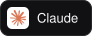
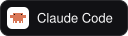
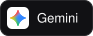
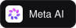
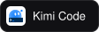

# agent-deeplinks

**Agents are the new frontend.** Open your app directly inside ChatGPT, Claude, Cursor, Codex, GitHub Copilot, and more with a single deep link.

[deeplinks.fun](https://deeplinks.fun) · [npm](https://www.npmjs.com/package/agent-deeplinks) · [Research notes](research/README.md)

<p>
  <a href="https://chatgpt.com/?q=tell%20me%20about%20deeplinks.fun&disable_auto_send=1&no_universal_links=1"></a>
  <a href="https://claude.ai/new?q=tell%20me%20about%20deeplinks.fun"></a>
  <a href="https://cursor.com/link/prompt?text=tell%20me%20about%20deeplinks.fun"></a>
  <a href="https://claude.ai/code/new?q=tell%20me%20about%20deeplinks.fun"></a>
  <a href="https://github.com/copilot/app/launch?open=ghapp%3A%2F%2Fsession%2Fnew%3Fprompt%3Dtell%2520me%2520about%2520deeplinks.fun"></a>
  <a href="https://gemini.google.com/app?q=tell%20me%20about%20deeplinks.fun"></a>
  <a href="https://www.perplexity.ai/search?q=tell%20me%20about%20deeplinks.fun&s=o"></a>
  <a href="https://grok.com/?q=tell%20me%20about%20deeplinks.fun&stay_in_browser=true"></a>
  <a href="https://app.t3.codes/new?prompt=tell%20me%20about%20deeplinks.fun"></a>
  <a href="https://cursor.com/grok-bot/link/v1/prompt?text=tell%20me%20about%20deeplinks.fun"></a>
  <a href="https://www.meta.ai/?prompt=tell%20me%20about%20deeplinks.fun"></a>
  <a href="https://chatgpt.com/codex"></a>
  <a href="https://antigravity.google.com/remote"></a>
  <a href="https://grok.com/build"></a>
  <a href="https://www.kimi.ai/"></a>
  <a href="https://code-rc.kimi.ai/"></a>
  <a href="https://muse.ai/chat?nr=1"></a>
  <a href="https://zcode.z.ai/remote/v4?app_version=4.0.0"></a>
  <a href="https://deeplinks.fun"></a>
  <a href="https://deeplinks.fun"></a>
  <a href="https://deeplinks.fun"></a>
</p>

Try Desktop & Mobile native links (`claude://`, `cursor://`, `codex://`, `ghapp://`, `openclaw://`, `opencode://`, `hermes://`) live at **[deeplinks.fun](https://deeplinks.fun)** — GitHub strips non-HTTPS URI schemes in READMEs.

## Install

```sh
npm install agent-deeplinks
```

The [GitHub release ZIP](https://github.com/lalalune/agent-deeplinks/releases/latest/download/agent-deeplinks.zip) includes the npm tarball, SVGs, and static shadcn/ui demo. The playground offers icon-only and labeled buttons. Workspace and self-hosted examples accept your folder or server address.

## Quick start

Works in any TypeScript or JavaScript project, with no React required:

```ts
import { getAgentLink, getAgentRoute, getAgentIcon } from "agent-deeplinks"

const url = getAgentLink("claude", "desktop", {
  prompt: "tell me about deeplinks.fun",
})
// => "claude://claude.ai/new?q=tell%20me%20about%20deeplinks.fun"

const route = getAgentRoute("claude", "desktop") // fields, behavior, evidence, sources
const icon = getAgentIcon("claude") // data:image/svg+xml,...
```

- `getAgentLink(agent, platform, options)` returns a URL string, or `null` if the route is unavailable, inputs are invalid, or an opt-in is required.
- Platforms: `"web" | "desktop" | "ios" | "android" | "cli" | "vscode"`.
- Opt-in flags: pass `allowExperimental: true` for unconfirmed prompt routes (`claude`, `gemini`, `grok`, `meta-ai`, `kimi` Android) and `allowSend: true` for routes that auto-submit (`perplexity`).
- Helpers: `browserOnly: true` appends `#no_universal_links` on supported web routes; `getHermesSkillLink("official/security/1password")` builds Hermes Desktop skill installs; `getOpenCodeAndroidPairingLink(url)` converts OpenCode CLI pairing URLs to `opencode://pair`.

On Android, Claude's default link opens the installed app through its HTTPS App Link. Use `shared-chat` for a public Claude share or `getAgentLink("claude", "android", { action: "install" })` to send someone to Google Play.

### Existing desktop chats

Choose **Existing chat** for Claude, ChatGPT, or Codex in the desktop playground. Use the UUID from a Claude conversation URL. ChatGPT and Codex also accept the link from **Copy chat deep link**, including the owning host ID for an SSH chat. The desktop app needs access to the chat and its connection. [Claude desktop links](https://support.claude.com/en/articles/14729294-open-claude-desktop-with-a-link) · [ChatGPT desktop commands](https://learn.chatgpt.com/docs/reference/commands#deep-links) · [Codex SSH test](research/evidence/codex-copied-remote-thread/native-ssh-reopen-proof.json)

```ts
const chatId = "12345678-1234-4234-9234-123456789abc"
getAgentLink("claude", "desktop", { session: chatId })
getAgentLink("codex", "desktop", { session: `codex://threads/${chatId}` })
```

### Claude Code desktop workspaces

Choose **Claude Code → Workspace link** in the desktop playground to try a local folder or SSH target. Claude Code asks you to review the destination. The prompt stays unsent.

```ts
getAgentLink("claude-code", "desktop", {
  folder: "/absolute/path/to/project",
  prompt: "Review this workspace.",
})

getAgentLink("claude-code", "desktop", {
  sshHost: "dev@build.example.test",
  sshPort: "2222",
  sshFolder: "~/project",
  prompt: "Review this workspace.",
})
```

### Open a terminal or VS Code draft

Under **Desktop** in the playground, choose **Claude Code → Terminal**, **Claude Code → VS Code**, or **GitHub Copilot → VS Code Agents**. Claude Code Terminal takes a local directory or a GitHub repository slug. The VS Code extension can reopen a session from the open workspace. VS Code Agents requires a draft prompt in VS Code 1.148.0 and accepts an optional workspace folder URI. The prompts stay unsent. [Claude Code terminal links](https://code.claude.com/docs/en/deep-links) · [Claude Code extension](https://code.claude.com/docs/en/vs-code#launch-a-vs-code-tab-from-other-tools) · [VS Code Agents draft links](https://code.visualstudio.com/docs/configure/command-line#_prepare-a-new-agent-session-draft) · [VS Code 1.148.0 parser tests](https://github.com/microsoft/vscode/blob/661626d0e72f97806550790a98fb87116c9db825/src/vs/platform/window/test/common/window.test.ts#L77)

```ts
getAgentLink("claude-code", "cli", {
  cwd: "/absolute/path/to/project",
  prompt: "Review this workspace.",
})
getAgentLink("claude-code", "vscode", { prompt: "Review this workspace." })
getAgentLink("github-copilot", "vscode", {
  workspace: "file:///absolute/path/to/project",
  prompt: "Review this workspace.",
})
```

### Open a local file in Antigravity IDE

Choose **Antigravity → IDE file or folder** under Desktop in the playground. Enter the absolute path to a file, folder, or workspace on this computer. The standalone IDE may ask for confirmation before opening it. [Google Antigravity downloads](https://antigravity.google/download?app=antigravity-ide)

```ts
getAgentLink("antigravity", "desktop", {
  action: "ide-open",
  target: "/Users/example/project/README.md",
})
// antigravity-ide://file/Users/example/project/README.md
```

### OpenClaw Gateway sessions

Choose **Configure OpenClaw** in the Web or Android playground and enter your Gateway address. Sign in to the Gateway in the same tab, then go back and paste a session link copied from OpenClaw. You can add an unsent draft to a Chat or Dashboard session. Use Focus and Beam links with an empty draft. [OpenClaw URL guide](https://docs.openclaw.ai/web/urls) · [Live playground](https://deeplinks.fun/)

### OpenCode browser sessions and desktop drafts

On **Web** or **Mobile → iOS**, choose **Configure OpenCode**. Enter your OpenCode 2.x server origin and paste a session ID or copy the session's address from your browser. Sign in to that server in the browser where you open the link. On **Desktop**, choose **OpenCode → project draft** to open a local folder and optionally prefill an unsent prompt. [OpenCode Web guide](https://opencode.ai/docs/cli/web/) · [Live playground](https://deeplinks.fun/)

```ts
getAgentLink("opencode", "web", {
  server: "https://code.example.com",
  session: "ses_example",
})

getAgentLink("opencode", "desktop", {
  directory: "/absolute/path/to/project",
  prompt: "Review this project",
})
```

### OpenCode on Android

Pair a server in OpenCode first. Use the Android app's **Copy Session ID** action to open a saved session on the active server. If your integration already has the full Android AppSearch URI, pass it as `session` to preserve the saved server. For a blank draft in a specific project on the active server, pass its `id` from that server's `GET /api/project` response as `project` with `mode: "new"`. [OpenCode API](https://opencode.ai/docs/api#project.list) · [Android link research](research/coding-agents.md#opencode) · [Live playground](https://deeplinks.fun/)

```ts
getAgentLink("opencode", "android", { session: "ses_fixture" })
// opencode://session/ses_fixture

getAgentLink("opencode", "android", {
  session: "opencode://session/ses_fixture?server=676517cbf8eb",
})
// opencode://session/ses_fixture?server=676517cbf8eb

getAgentLink("opencode", "android", { mode: "new", project: "prj_fixture" })
// opencode://new-session?project=prj_fixture
```

## Apps, plugins, MCP & skills

Beyond chat drafts, `agent-deeplinks` builds action links for plugin apps, marketplace listings, MCP installs, skills, commands, rules, shared chats, and server pairing. Discover available actions with `getAgentActions(agent, platform)` and pass `action` to `getAgentLink`:

```ts
import { getAgentActions, getAgentLink } from "agent-deeplinks"

const actions = getAgentActions("chatgpt", "web")

const appUrl = getAgentLink("chatgpt", "web", {
  action: "app",
  target: "plugin_asdk_app_6abadab6e7d881919e7491d52c7846e8",
  tool: "cad.browse",
  appPath: "/parts/part_joystick",
})

const pluginChatUrl = getAgentLink("codex", "desktop", {
  action: "plugin-chat",
  target: "openai-developers@openai-curated",
  prompt: "Find the docs for app deep links.",
})
```

See [research/plugin-links.md](research/plugin-links.md) for all supported action IDs, parameters, and provider requirements.

In the playground, paste your own Cursor or Grok Build **Cloud Agent** link, Cursor **Origin PR** link, or Cursor **Shared transcript** link. Viewing these destinations requires the access granted by their owner. For a Cursor transcript in a desktop or mobile browser, use `shared-chat` with the share ID or the full `https://cursor.com/s/…` URL. [Cursor shared transcripts](https://cursor.com/help/ai-features/shared-transcripts)

Use **Shared chat** to paste a ChatGPT, Claude, Codex, Grok, Kimi, or ZCode share link. The playground offers each provider on its supported targets and keeps Kimi's public chat example available. In your code, pass the link as `target` with `action: "shared-chat"` to `getAgentLink`. The link retains the author's sharing permissions.

Use **T3 Code → Pull request** or pass `{ action: "pull-request", target: "owner/repo#123", prompt: "Review the changes." }` to `getAgentLink("t3-code", platform, options)`. The target can also be a GitHub pull request URL. The prompt is optional. T3 Code can open a linked thread or offer a new draft for the connected project. [T3 Code pull request link parser](https://github.com/pingdotgg/t3code/blob/v0.1.13/packages/shared/src/promptLinks.ts)

Use **T3 Code → Existing thread** to open a URL from T3 Code's **Copy → Thread** menu or the mobile **Copy thread** action. Pass the same URL as `session` to `getAgentLink("t3-code", platform, options)` in your app. You can add a draft through `prompt` or use the draft already in the pasted URL. Opening the thread requires the connected environment that owns it. [T3 Code's Copy thread implementation](https://github.com/pingdotgg/t3code/pull/26290)

## React & shadcn/ui

Compose `<AgentLink>` with your existing [shadcn/ui Button](https://ui.shadcn.com/docs/components/radix/button) via `asChild`:

```tsx
import { Button } from "@/components/ui/button"
import { AgentLink, AgentIcon } from "agent-deeplinks/react"

const options = { prompt: "tell me about deeplinks.fun" }

export function OpenInCodex() {
  return (
    <>
      <Button asChild variant="outline">
        <AgentLink agent="codex" platform="desktop" options={options} />
      </Button>
      <Button asChild variant="outline" size="icon">
        <AgentLink agent="codex" platform="desktop" options={options} iconOnly />
      </Button>
      <AgentIcon agent="codex" width={20} height={20} />
    </>
  )
}
```

`<AgentLink>` renders `null` for unavailable or invalid routes (and accepts the same `action` options with custom link text as `children`). Standalone SVGs are also exported directly:

```ts
import cursorIcon from "agent-deeplinks/icons/cursor.svg"
```

## Supported agents

| Agent | ID | Platforms | Native scheme |
| --- | --- | --- | --- |
| ChatGPT | `chatgpt` | `web`, `desktop`, `ios`, `android` | `codex://threads/new?mode=chat` |
| Claude | `claude` | `web`, `desktop`, `ios`, `android` | `claude://claude.ai/new` |
| Cursor | `cursor` | `web`, `desktop`, `ios`, `android` | `cursor://anysphere.cursor-deeplink/prompt` |
| Claude Code | `claude-code` | `web`, `desktop`, `ios`, `android`, `cli`, `vscode` | `claude://code/new`, `claude-cli://open`, `vscode://anthropic.claude-code/open` |
| Codex | `codex` | `web`, `desktop`, `ios`, `android` | `codex://new` |
| GitHub Copilot | `github-copilot` | `web`, `desktop`, `vscode` | `ghapp://session/new`, `vscode://agents/new` |
| Gemini | `gemini` | `web`, `ios`, `android` | Universal / App Links |
| Perplexity | `perplexity` | `web`, `ios` | Universal Link (`/search`) |
| Grok | `grok` | `web`, `ios`, `android` | Universal / App Links |
| Grok Build | `grok-build` | `web`, `ios`, `android` | Universal / App Links |
| Grok Bot | `grok-bot` | `web`, `desktop`, `ios`, `android` | `grokbot://app/v1/prompt` |
| T3 Code | `t3-code` | `web`, `desktop`, `ios`, `android` | `t3code://new` |
| OpenClaw | `openclaw` | `web`, `desktop`, `ios`, `android` | `openclaw://agent`, `openclaw://dashboard` |
| Meta AI | `meta-ai` | `web` | — |
| Antigravity | `antigravity` | `web`, `desktop`, `ios`, `android` | `antigravity://open`, `antigravity://` |
| OpenCode | `opencode` | `web`, `desktop`, `ios`, `android` | `opencode://new-session`, `opencode://` |
| Kimi | `kimi` | `web`, `desktop`, `ios`, `android` | `kimi-work://home`, `kimi://page/chat` |
| Kimi Code | `kimi-code` | `web`, `desktop`, `ios`, `android` | `kimi-code://open` |
| Meta Muse | `meta-muse` | `web`, `desktop`, `ios`, `android` | Universal Links |
| ZCode | `zcode` | `web`, `desktop`, `ios`, `android` | `zcode://workspace/open` |
| Hermes Agent | `hermes` | `web`, `desktop`, `ios`, `android` | `hermes://launch`, `hermes://skill/install` |

See [research/README.md](research/README.md) for per-platform parameters, limits, and evidence notes, and [icons/README.md](icons/README.md) for SVG sources and trademark info.

## Develop

```sh
npm ci
npm run dev       # run deeplinks.fun locally
npm run check     # generate icons + typecheck
npm test          # build package + run test suite
npm run build     # build package (dist/) + site (site/dist/)
```
