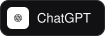
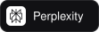
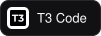
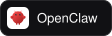
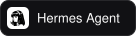

# agent-deeplinks

**Agents are the new frontend.** Open your app directly inside ChatGPT, Claude, Cursor, Codex, GitHub Copilot, and more with a single deep link.

[deeplinks.fun](https://deeplinks.fun) · [npm](https://www.npmjs.com/package/agent-deeplinks) · [Research notes](research/README.md)

<p>
  <a href="https://chatgpt.com/?q=tell%20me%20about%20deeplinks.fun&disable_auto_send=1&no_universal_links=1"></a>
  <a href="https://claude.ai/new?q=tell%20me%20about%20deeplinks.fun"></a>
  <a href="https://cursor.com/link/prompt?text=tell%20me%20about%20deeplinks.fun"></a>
  <a href="https://claude.ai/code/new?q=tell%20me%20about%20deeplinks.fun"></a>
  <a href="https://github.com/copilot/app/launch?open=ghapp%3A%2F%2Fsession%2Fnew%3Fprompt%3Dtell%2520me%2520about%2520deeplinks.fun"></a>
  <a href="https://gemini.google.com/app?q=tell%20me%20about%20deeplinks.fun"></a>
  <a href="https://www.perplexity.ai/search?q=tell%20me%20about%20deeplinks.fun&s=o"></a>
  <a href="https://grok.com/?q=tell%20me%20about%20deeplinks.fun&stay_in_browser=true"></a>
  <a href="https://app.t3.codes/new?prompt=tell%20me%20about%20deeplinks.fun"></a>
  <a href="https://cursor.com/grok-bot/link/v1/prompt?text=tell%20me%20about%20deeplinks.fun"></a>
  <a href="https://www.meta.ai/?prompt=tell%20me%20about%20deeplinks.fun"></a>
  <a href="https://chatgpt.com/codex"></a>
  <a href="https://antigravity.google.com/remote"></a>
  <a href="https://grok.com/build"></a>
  <a href="https://www.kimi.ai/"></a>
  <a href="https://code-rc.kimi.ai/"></a>
  <a href="https://muse.ai/chat?nr=1"></a>
  <a href="https://zcode.z.ai/remote/v4?app_version=4.0.0"></a>
  <a href="https://deeplinks.fun"></a>
  <a href="https://deeplinks.fun"></a>
  <a href="https://deeplinks.fun"></a>
</p>

Try Desktop & Mobile native links (`claude://`, `cursor://`, `codex://`, `ghapp://`, `openclaw://`, `opencode://`, `hermes://`) live at **[deeplinks.fun](https://deeplinks.fun)** — GitHub strips non-HTTPS URI schemes in READMEs.

## Install

```sh
npm install agent-deeplinks
```

Standalone ZIP archives with the bundled SVGs and static demo are also published on [GitHub Releases](https://github.com/lalalune/agent-deeplinks/releases/latest).

## Quick start

Works in any TypeScript or JavaScript project, with no React required:

```ts
import { getAgentLink, getAgentRoute, getAgentIcon } from "agent-deeplinks"

const url = getAgentLink("claude", "desktop", {
  prompt: "tell me about deeplinks.fun",
})
// => "claude://claude.ai/new?q=tell%20me%20about%20deeplinks.fun"

const route = getAgentRoute("claude", "desktop") // fields, behavior, evidence, sources
const icon = getAgentIcon("claude") // data:image/svg+xml,...
```

- `getAgentLink(agent, platform, options)` returns a URL string, or `null` if the route is unavailable, inputs are invalid, or an opt-in is required.
- Platforms: `"web" | "desktop" | "ios" | "android" | "cli" | "vscode"`.
- Opt-in flags: pass `allowExperimental: true` for unconfirmed prompt routes (`claude`, `gemini`, `grok`, `meta-ai`, `kimi` Android) and `allowSend: true` for routes that auto-submit (`perplexity`).
- Helpers: `browserOnly: true` appends `#no_universal_links` on supported web routes; `getHermesSkillLink("official/security/1password")` builds Hermes Desktop skill installs; `getOpenCodeAndroidPairingLink(url)` converts OpenCode CLI pairing URLs to `opencode://pair`.

## Apps, plugins, MCP & skills

Beyond chat drafts, `agent-deeplinks` builds action links for plugin apps, marketplace listings, MCP installs, skills, commands, rules, shared chats, and server pairing. Discover available actions with `getAgentActions(agent, platform)` and pass `action` to `getAgentLink`:

```ts
import { getAgentActions, getAgentLink } from "agent-deeplinks"

const actions = getAgentActions("chatgpt", "web")

const appUrl = getAgentLink("chatgpt", "web", {
  action: "app",
  target: "plugin_asdk_app_6abadab6e7d881919e7491d52c7846e8",
  tool: "cad.browse",
  appPath: "/parts/part_joystick",
})

const pluginChatUrl = getAgentLink("codex", "desktop", {
  action: "plugin-chat",
  target: "openai-developers@openai-curated",
  prompt: "Find the docs for app deep links.",
})
```

See [research/plugin-links.md](research/plugin-links.md) for all supported action IDs, parameters, and provider requirements.

## React & shadcn/ui

Compose `<AgentLink>` with your existing [shadcn/ui Button](https://ui.shadcn.com/docs/components/radix/button) via `asChild`:

```tsx
import { Button } from "@/components/ui/button"
import { AgentLink, AgentIcon } from "agent-deeplinks/react"

const options = { prompt: "tell me about deeplinks.fun" }

export function OpenInCodex() {
  return (
    <>
      <Button asChild variant="outline">
        <AgentLink agent="codex" platform="desktop" options={options} />
      </Button>
      <Button asChild variant="outline" size="icon">
        <AgentLink agent="codex" platform="desktop" options={options} iconOnly />
      </Button>
      <AgentIcon agent="codex" width={20} height={20} />
    </>
  )
}
```

`<AgentLink>` renders `null` for unavailable or invalid routes (and accepts the same `action` options with custom link text as `children`). Standalone SVGs are also exported directly:

```ts
import cursorIcon from "agent-deeplinks/icons/cursor.svg"
```

## Supported agents

| Agent | ID | Platforms | Native scheme |
| --- | --- | --- | --- |
| ChatGPT | `chatgpt` | `web`, `desktop`, `ios`, `android` | `codex://threads/new?mode=chat` |
| Claude | `claude` | `web`, `desktop`, `ios`, `android` | `claude://claude.ai/new` |
| Cursor | `cursor` | `web`, `desktop`, `ios`, `android` | `cursor://anysphere.cursor-deeplink/prompt` |
| Claude Code | `claude-code` | `web`, `desktop`, `ios`, `android`, `cli`, `vscode` | `claude://code/new`, `claude-cli://open`, `vscode://anthropic.claude-code/open` |
| Codex | `codex` | `web`, `desktop`, `ios`, `android` | `codex://new` |
| GitHub Copilot | `github-copilot` | `web`, `desktop`, `vscode` | `ghapp://session/new`, `vscode://agents/new` |
| Gemini | `gemini` | `web`, `ios`, `android` | Universal / App Links |
| Perplexity | `perplexity` | `web`, `ios` | Universal Link (`/search`) |
| Grok | `grok` | `web`, `ios`, `android` | Universal / App Links |
| Grok Build | `grok-build` | `web`, `ios`, `android` | Universal / App Links |
| Grok Bot | `grok-bot` | `web`, `desktop`, `ios`, `android` | `grokbot://app/v1/prompt` |
| T3 Code | `t3-code` | `web`, `desktop`, `ios`, `android` | `t3code://new` |
| OpenClaw | `openclaw` | `web`, `desktop`, `ios`, `android` | `openclaw://agent`, `openclaw://dashboard` |
| Meta AI | `meta-ai` | `web` | — |
| Antigravity | `antigravity` | `web`, `desktop`, `ios`, `android` | `antigravity://open`, `antigravity://` |
| OpenCode | `opencode` | `web`, `desktop`, `ios`, `android` | `opencode://new-session`, `opencode://` |
| Kimi | `kimi` | `web`, `desktop`, `ios`, `android` | `kimi-work://home`, `kimi://page/chat` |
| Kimi Code | `kimi-code` | `web`, `desktop`, `ios`, `android` | `kimi-code://open` |
| Meta Muse | `meta-muse` | `web`, `desktop`, `ios`, `android` | Universal Links |
| ZCode | `zcode` | `web`, `desktop`, `ios`, `android` | `zcode://workspace/open` |
| Hermes Agent | `hermes` | `web`, `desktop`, `ios`, `android` | `hermes://launch`, `hermes://skill/install` |

See [research/README.md](research/README.md) for per-platform parameters, limits, and evidence notes, and [icons/README.md](icons/README.md) for SVG sources and trademark info.

## Develop

```sh
npm ci
npm run dev       # run deeplinks.fun locally
npm run check     # generate icons + typecheck
npm test          # build package + run test suite
npm run build     # build package (dist/) + site (site/dist/)
```
